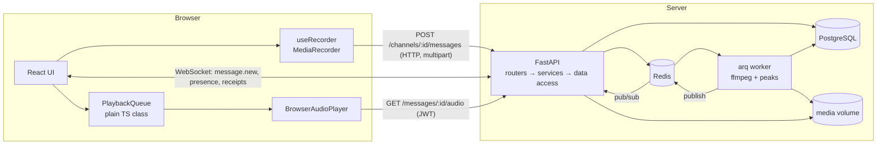

# PushTalk

A walkie-talkie style web app. Users in a shared channel hold a button to record a short voice
message (0.5 s to 60 s). The message is sent when they release the button, and other members hear
it automatically, one after another.

> **Scope note.** I applied for a frontend role, and the brief says it is not necessary to complete
> both sides. I put most of the effort into the **frontend**. The backend is intentionally
> smaller. See [Status](#status) for exactly what is done and [What I cut and why](#what-i-cut-and-why).

## Tech stack

| Layer | Choice |
|---|---|
| Frontend | React + TypeScript, Vite, Tailwind, shadcn/ui, React Hook Form + Zod, React Router, TanStack Query |
| Tests (frontend) | Vitest |
| Backend | Python 3.12, FastAPI |
| Database | PostgreSQL (Alembic migrations) |
| Messaging / jobs | Redis (pub/sub), arq (background jobs) |
| Audio processing | ffmpeg (normalise to Opus/OGG, duration, waveform peaks) |
| Media storage | Local Docker volume behind a `StorageService` class |

## Status

Update this table as work lands. Be honest about it; reviewers read it first.

| Area | State |
|---|---|
| Docker Compose skeleton (api, db, redis) + `/health` | Done |
| Frontend: login / signup with password rules and strength meter | Done (mock auth) |
| Frontend: channels page, sidebar, room header, members strip | Done (mock data) |
| Frontend: recorder (hold to talk, 0.5 s min, 60 s max, mic errors) | Done |
| Frontend: playback queue (no overlap, own messages skipped, ordered by `seq`, pause while recording, manual play, continue-after-manual) | Done, unit tested |
| Frontend: enable-audio overlay (autoplay policy) | Done |
| Frontend: message history pagination (last 20, load older on scroll) | Done (mock data) |
| Frontend: `api.ts`, `socket.ts` (reconnect with backoff, catch-up) | Not started |
| Backend: auth, channels, upload validation, worker, WebSocket | Not started |
| Backend tests | Not started |

## Run it

### Everything (target state)

```bash
cp .env.example .env        # then edit the secrets
docker compose up --build
```

- API: http://localhost:8000 (docs at `/docs`, health at `/health`)

### Frontend on its own (works today, on mock data)

```bash
cd frontend
npm install
npm run dev                 # http://localhost:5173
npm test                    # playback queue unit tests
```

The room page plays `frontend/public/sample.mp3` for every message. This is a placeholder until the
backend serves real audio, and it should be removed then.

Use the latest Chrome. The microphone only works on `https` or `localhost`.

## Architecture



Message flow (target design):

1. The sender records and releases. The browser uploads over **HTTP**.
2. The API validates the file (real MIME type, size, real duration), saves the message as
   `processing`, enqueues a job and returns `202`.
3. The worker converts to Opus/OGG, extracts duration and waveform peaks, assigns the channel
   `seq`, marks the message `sent` and publishes an event to Redis.
4. The API pushes `message.new` to channel members over WebSocket.
5. Recipients fetch the audio over an authenticated endpoint and the playback queue plays it.

### Frontend structure

```
src/
├── components/   presentation only, props in
│   ├── ui/       shadcn (generated)
│   ├── auth/  channelsPage/  channelRoomPage/  layout/  shared/
├── hooks/        glue between React and the logic (useRecorder, usePlaybackQueue, ...)
├── lib/          plain TypeScript, no React (playbackQueue, audioPlayer, format)
├── schemas/      Zod schemas
├── mocks/        mock data, removed when the backend is connected
├── pages/        compose components and hooks
└── types/
```

## Known limitations

- Backend is incomplete (see [Status](#status)). The frontend runs on mock data.
- Auth is a mock. No real JWT yet.
- The playback queue holds state in memory. A page refresh clears it and the enable-audio overlay
  appears again, because the browser does not remember the user gesture.
- `pause()` during audio **download** (before the `Audio` element exists) has no effect.
- Chrome records `webm/opus`, Safari records `mp4/aac`. Only Chrome is supported. Normalising the
  format in the worker is the planned fix for other browsers.
- Token storage in `sessionStorage` is exposed to XSS. An httpOnly cookie would be safer.
- No component or hook tests for `useRecorder` (needs `MediaRecorder` mocks).

## What I cut and why

| Cut | Reason |
|---|---|
| Direct messages, transcription, per-user rate limiting | Stretch goals; the core comes first |
| Playback speed control | Stretch goal. It is one line (`audio.playbackRate`) in `BrowserAudioPlayer` |
| Leave channel, private channels, invitations | Not in the user stories |
| Email field on signup | The brief asks for username and password only |
| Keyboard shortcuts, latency and buffer indicators from the design | Not required |
| Per-recipient receipts | Considering aggregated status only (sent → delivered → played) |

See [DECISIONS.md](./DECISIONS.md) for the design questions and trade-offs, and
[AI_USAGE.md](./AI_USAGE.md) for AI disclosure.